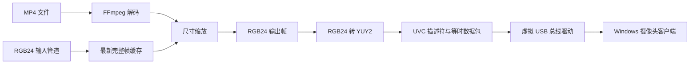

# 项目结构与数据流

## 组件职责

| 路径 | 职责 |
|---|---|
| `src/app/main.cpp` | 参数解析、控制管道启动和进程退出顺序 |
| `src/app/control_server.*` | 本机命名管道命令协议与请求路由 |
| `src/app/web_server.*` | 绑定 loopback 的本机 Web UI、预览和设置 API |
| `src/app/runtime_controller.*` | Web 设置应用、管道重建、配置持久化和状态快照 |
| `src/app/app_config.*` | EXE 旁 `camera.ini` 的校验、读取和原子保存 |
| `src/camera/camera_session.*` | 摄像头状态、热更新、工作线程和失败回滚 |
| `src/camera/uvc_device.*` | UVC 描述符、类控制请求和等时数据包 |
| `src/media/frame_source.*` | FFmpeg 解码、缩放和 RGB24 到 YUY2 转换 |
| `src/media/pipe_reader.*` | RGB24 输入管道连接、帧校验和最新帧缓存 |
| `src/common/` | Win32 句柄 RAII、分辨率约束、可取消管道 I/O 和管道 ACL |
| `src/usb/transport.h` | 可替换的 USB 传输接口和设备身份 |
| `src/usb/virt_dev.*` | SetupAPI 枚举和既有虚拟总线驱动 IOCTL |
| `src/usb/ioctl.h` | 与已编译内核驱动的 ABI 约定 |
| `tools/python/vcam_tools/` | Python 配置、OBS、帧传输和控制客户端共享实现 |
| `config/`、`scripts/`、`tests/` | 默认配置、构建/验证脚本和自动化测试 |

## 帧处理路径

输入和 UVC 输出尺寸相互独立。MP4 每帧按实际解码尺寸配置缩放器；管道帧先完整读取，再替换最新帧缓存。USB 回调只取缓存，不等待管道客户端。客户端断开后服务端清除缓存并继续等待新连接；没有新帧时向 UVC 端提供黑帧。

## 线程和资源生命周期

- 应用创建帧源，再创建摄像头会话和控制服务；退出时先停止并等待控制线程，再停止摄像头工作线程，最后释放帧源。
- 摄像头工作线程独占 USB 事务循环；停止事件和传输中断用于取消阻塞 I/O，线程 join 完成后才释放其访问的对象。
- 每个帧源的输入管道线程只发布完整 RGB 帧。停止时取消正在进行的重叠 I/O，并等待线程退出。
- Win32 句柄用 move-only RAII 封装。驱动事务缓冲区在传输对象内持有，开始/结束事务期间地址保持稳定。
- 分辨率变更先分配新描述符与帧缓冲，再停止旧会话、移除设备并重新枚举。若新设备启动失败，会尝试恢复旧描述符和设备状态。
- Web UI 只绑定 `127.0.0.1`；每次启动生成随机令牌，API 校验令牌和来源。设置写入 `camera.ini` 临时文件后原子替换。
- RGB 输入管道默认仅对象所有者与 SYSTEM；控制管道默认 Everyone，并可选 Users 或 owner。两者均拒绝远程客户端。输入客户端断开后监听线程清除旧帧并继续等待重连。

## USB 与驱动边界

`src/usb/ioctl.h` 中的接口 GUID、结构体布局和 IOCTL 是用户态与既有内核驱动之间的二进制契约。当前仓库没有总线驱动完整源码。测试通过假传输验证 UVC 协议和会话行为，不替代真实驱动的端到端测试。更改 ABI 前需要对应驱动源码或兼容设备验证。

TCP 和本机帧管道使用相同的 RGB24 帧格式；控制管道是独立的文本命令通道。协议详见[运行与输入协议](usage.md)和[控制管道协议](control-protocol.md)。
