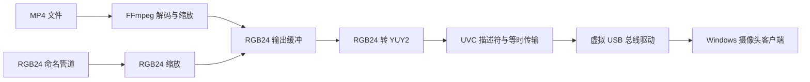

# 项目结构与数据流

## 目录职责

| 路径 | 职责 |
|---|---|
| `src/app/main.cpp` | 命令行解析、程序工作目录和摄像头实例生命周期 |
| `src/camera/uvc_vcam.cpp/.h` | UVC 描述符、摄像头实例、控制请求和等时帧传输 |
| `src/media/frame_source.cpp/.h` | MP4/命名管道输入、FFmpeg 解码、RGB24 缩放与 RGB24→YUY2 转换 |
| `src/protocol/uvc_struct.h` | UVC 与 USB 描述符结构 |
| `src/usb/virt_dev.cpp/.h` | 通过 SetupAPI 查找设备接口并发送虚拟总线 IOCTL |
| `src/usb/ioctl.h` | 与已编译内核驱动之间的 IOCTL 和接口 GUID 约定 |
| `config/default_res.txt` | UVC 对主机公布的唯一分辨率 |
| `drivers/usb-bus-legacy/` | 上游附带的 x86/x64 旧版二进制驱动包 |
| `tools/python/` | OBS、Hyper-V/TCP、纯色帧和管道预览工具 |
| `scripts/` | FFmpeg/Python 环境准备和 MSBuild 封装 |
| `docs/` | 当前有效的使用、构建、架构和来源说明 |
| `archive/legacy-2016/` | 原始历史说明及旧驱动接口源码，只用于理解来源，不作为当前操作指南 |

## 帧流路径

MP4 和命名管道共用同一固定 UVC 输出分辨率。MP4 由 FFmpeg 转换到输出尺寸；管道输入先按客户端头部的 RGB24 尺寸创建缩放上下文。摄像头帧缓冲区使用 YUY2，格式标识为 UVC YUY2。

## 协议边界

应用与内核驱动之间通过 `src/usb/ioctl.h` 中的接口 GUID、IOCTL 结构和 USB 设备描述符交互。该文件不是驱动源码；改变结构体布局、字段宽度或 IOCTL 编号可能破坏二进制兼容性。任何此类修改都需要驱动端源码或与已知驱动做端到端验证。

管道与 TCP 帧输入协议记录在[运行与输入协议](usage.md)。TCP 仅负责把相同的 RGB24 帧流送到命名管道；转换和 UVC 传输仍由 Windows C++ 程序负责。

## 扩展建议

新增输入源应输出带明确尺寸和 stride 的 RGB24 图像，统一在帧源边界做验证和缩放，再交给 YUY2 转换。新增依赖时同步维护构建校验、Release 运行时复制和本目录文档。不要直接修改旧 INF 或 `.cat` 来“修正”驱动包；INF 改动会使已有目录签名不再对应当前内容。
